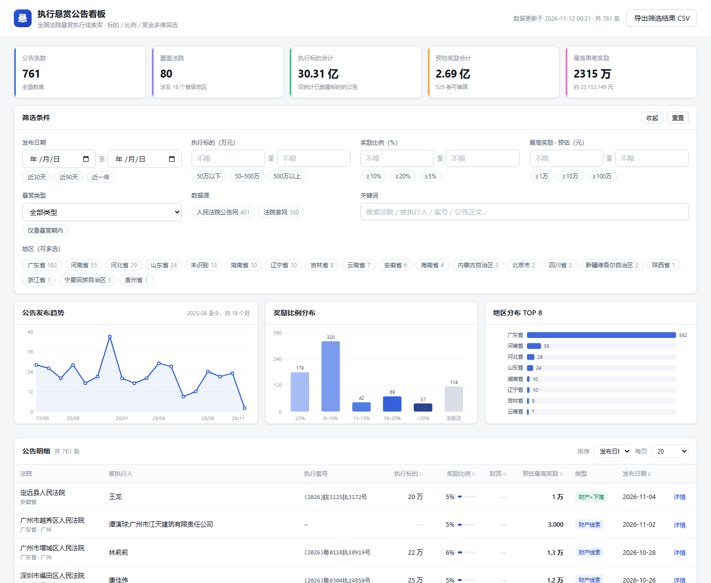
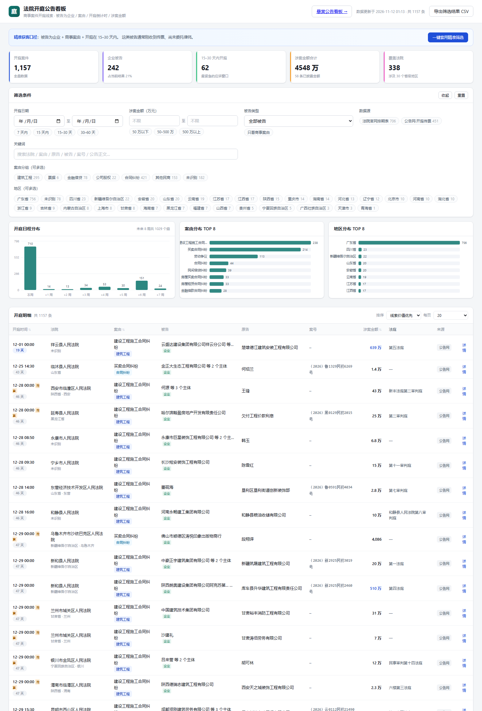

# 法院公告雷达 · Bounty Radar

采集全国法院公开发布的司法公告，解析成结构化数据库，并通过两块可筛选看板展示：

| 看板 | 入口 | 用途 |
|---|---|---|
| **执行悬赏公告** | `index.html` | 按标的 / 奖励比例 / 赏金找可执行的财产线索 |
| **法院开庭公告** | `hearings.html` | 按案由 / 被告类型 / 开庭倒计时找有应诉需求的商事案件 |

[](https://github.com/bytemineur/bounty-radar/actions/workflows/ci.yml)
[](https://www.python.org/)
[](#技术选型)
[](#docker-启动推荐)
[](LICENSE)



- 数据源：人民法院公告网（全国）+ 深圳中院 / 南山 / 福田等法院官网栏目 + 法院官网开庭排期表
- 技术栈：Python 标准库 + SQLite + 原生 HTML/JS，**零第三方依赖**
- 当前库存：悬赏公告 **761 条**（80 家法院 / 18 个省级行政区），开庭公告 **1157 条**（338 家法院 / 30 个省级行政区，其中企业被告 242 条）
- 悬赏字段覆盖：被执行人 88%、执行标的 72%、奖励比例 84%、可推算奖励 66%
- 开庭字段覆盖：案由 99%、开庭日期 90%、被告 39%、涉案金额 5%（多数传票公告不写标的额）

## Docker 启动（推荐）

```bash
git clone https://github.com/bytemineur/bounty-radar.git
cd bounty-radar
docker compose up -d --build
```

打开 <http://localhost:8848/index.html>（悬赏看板）或 <http://localhost:8848/hearings.html>（开庭看板）即可。容器内置已采集好的数据，不需要先跑采集。

常用操作：

```bash
docker compose logs -f dashboard              # 看日志
docker compose run --rm crawl                 # 悬赏：增量采集（公告网 + 法院官网）
docker compose run --rm crawl update          # 悬赏：采集 + 重新解析 + 导出，一条命令
docker compose run --rm --entrypoint python crawl cli.py crawl --source court  # 只抓法院官网
docker compose run --rm --entrypoint python crawl cli.py stats   # 查看悬赏库统计
docker compose run --rm crawl-hearing         # 开庭：采集 + 去重 + 导出
docker compose run --rm --entrypoint python dashboard cli.py hearing stats  # 开庭库统计
docker compose down                           # 停止
```

改端口：`PORT=9000 docker compose up -d`。

镜像说明：`python:3.12-slim` 基底，非 root（uid 1000）运行，暴露 8848，自带 healthcheck。
Linux 宿主机若遇到 `data/` 写权限报错，用 `docker compose run --rm --user "$(id -u):$(id -g)" crawl`。

也可以不用 compose：

```bash
docker build -t bounty-radar .
docker run -d --name bounty-radar -p 8848:8848 \
  -v "$PWD/web/data:/app/web/data:ro" bounty-radar
```

## 本地启动（不用 Docker）

零第三方依赖，Python 3.10+ 直接跑：

```bash
python cli.py init      # 初始化数据库
python cli.py stats     # 看库里的数据
python cli.py serve     # http://127.0.0.1:8848/index.html
```

采集与更新：

```bash
python cli.py crawl     # 悬赏全量采集（约 5 分钟，含限速）
python cli.py update    # 悬赏：采集 + 重新解析 + 导出
python cli.py reparse   # 改了正则后重跑全库解析
python cli.py export    # 只重新导出看板数据

python cli.py hearing crawl     # 开庭：采集（公告网开庭传票 + 法院排期表）
python cli.py hearing update    # 开庭：采集 + 去重 + 导出
python cli.py hearing reparse   # 开庭：改了案由词典后重解
python cli.py hearing stats     # 开庭库统计
python cli.py hearing serve     # 直接打开开庭看板
```

`serve` 支持 `--host`、`--port`、`--no-browser`，也读环境变量 `HOST` / `PORT`。

看板是纯静态的，也可以直接双击 `web/index.html` / `web/hearings.html`（数据以 JS 变量内嵌，`file://` 下可用）。

## 看板能力

- **发布日期**：区间筛选 + 近 30/90/365 天快捷键
- **执行标的**：万元区间 + 50 万以下 / 50–500 万 / 500 万以上
- **奖励比例**：百分比区间 + ≥10% / ≥20% / ≤5%
- **最高奖励（预估）**：金额区间 + ≥1 万 / ≥10 万 / ≥100 万
- **数据源**：人民法院公告网 / 法院官网，多选（带条数）
- **地区**：省级多选（带条数）
- **悬赏类型**：财产线索 / 下落行踪 / 两者
- **悬赏期有效性**：仅看当前仍在悬赏期内的公告
- **关键词**：全文检索法院、被执行人、案号、正文
- 表头点击排序（执行标的 / 奖励比例 / 封顶 / 预估奖励 / 发布日期）、分页、导出当前筛选结果为 CSV、详情弹窗（含公告全文与原文链接）

三个图表随筛选实时联动：发布趋势、比例分布、地区 TOP 8。

## 开庭公告看板

入口 `hearings.html`。目标是找出**刚收到传票、还没委托律师的商事被告**——这类主体的应诉需求最紧急。



看板顶部有一个「一键套用精准筛选」按钮，等价于：

> 被告类型 = 企业（含企业与个人混合）　+　案由 = 商事　+　开庭时间在 15–30 天内

为什么是 15–30 天：公告送达的开庭日通常在「公告期 30 日 + 答辩举证 15 日」之后，即发布后 45–75 天；落在 15–30 天窗口的，说明公告已经发出去一段时间，开庭在即，而被告仍未应诉。

**筛选维度**

- **开庭日期**：区间筛选 + 7 天内 / 15 天内 / 15–30 天 / 30–60 天
- **涉案金额**：万元区间 + 50 万以下 / 50–500 万 / 500 万以上
- **被告类型**：仅企业 / 企业+个人混合 / 仅自然人 / 未披露当事人
- **只看商事案由**：排除破产清算、仲裁确认、执行异议等非诉程序
- **案由分组**：建筑工程 / 票据 / 商标知产 / 金融借贷 / 公司股权 / 合同纠纷，多选
- **地区、数据源**：多选（带条数）
- **关键词**：全文检索法院、案由、原被告、案号、正文
- 表头点击排序（开庭时间 / 案由 / 涉案金额）、分页、导出 CSV、详情弹窗

三个图表随筛选联动：未来 8 周开庭日程、案由 TOP 8、地区 TOP 8。

**开庭字段**

| 字段 | 说明 |
|---|---|
| `court` / `province` / `city` | 审理法院及地区 |
| `case_no` / `case_kind` | 案号与案件类型（民初 / 民终 / 民再 …） |
| `cause` / `cause_group` | 案由与商事分组，案由用《民事案件案由规定》词典做最长后缀匹配 |
| `plaintiff` / `defendant` | 原告、被告 |
| `defendant_type` | `company` 企业 / `mixed` 企业与个人混合 / `person` 自然人 / `unknown` 未披露 |
| `hearing_at` / `hearing_date` | 开庭时间（`YYYY-MM-DD HH:MM`）与日期 |
| `time_estimated` | 公告未写具体日期、按「公告期 + 答辩期 + N 日」推算时为 1 |
| `courtroom` | 法庭 |
| `claim_amount` | 涉案金额（元），取诉讼请求中的最大一笔，剔除诉讼费/公告费等 |
| `amount_basis` | 金额来源：`诉讼请求` / `正文最大金额` |
| `parse_quality` | 解析置信度（0~1） |

**开庭数据源**

| source | 来源 | 覆盖 | 说明 |
|---|---|---|---|
| `rmfygg_kt` | [人民法院公告网](https://rmfygg.court.gov.cn) 的「开庭传票」「起诉状副本及开庭传票」两类公告 | 全国各级法院 | 全文含当事人、案由、案号、开庭时间、诉讼请求金额，是唯一能判断「被告是否为企业」的源 |
| `court_schedule` | 法院官网直接发布的开庭排期表（当前接入广州中院） | 单院全周排期 | 案由、开庭时间、法庭由法院录入，最准确；**不含当事人** |

新增排期表源：在 `config.SCHEDULE_SITES` 里加一条 `{court, url, kind: "table", province, city}` 即可，前提是目标页是「序号/法院/时间/法庭/案号/案由」六列表格。

## 数据字段

| 字段 | 说明 |
|---|---|
| `court` / `province` / `city` | 发布法院及其所属地区（由法院名推断） |
| `debtor` | 被执行人（可能多人，分号/顿号分隔） |
| `case_no` | 执行案号 |
| `subject_amount` | 执行标的额（元）。**公告未披露则为空**，当前覆盖率约 61% |
| `reward_ratio` | 悬赏奖励比例（导出为百分数，如 `10` 表示 10%）。覆盖率约 84% |
| `reward_cap` | 封顶金额（元），"最高不超过 X 元" |
| `reward_fixed` | 固定赏金（元），如"提供下落线索支付 1000 元" |
| `reward_est` | **预估最高奖励** = min(标的 × 比例, 封顶)，或固定赏金，取两者较大值 |
| `reward_type` | `property` 财产线索 / `whereabouts` 下落行踪 / `both` / `unknown` |
| `publish_date` / `valid_from` / `valid_to` | 发布日期与悬赏有效期 |
| `contact_phone` | 举报联系电话 |
| `parse_quality` | 解析置信度（0~1，按抽到的字段加权） |

## 目录结构

```
bounty-radar/
├── cli.py                        命令行入口（悬赏：init/crawl/update/…；开庭：hearing crawl/update/…）
├── config.py                     关键词、案由词典分组、排期表源、限速等配置
├── Dockerfile                    镜像定义（python:3.12-slim，非 root，自带 healthcheck）
├── docker-compose.yml            dashboard + crawl + crawl-hearing
├── Makefile                      常用命令封装
├── src/
│   ├── http_client.py            限速/重试/403 冷却/自动 TLS 降级的 HTTP 客户端
│   ├── sources/rmfygg.py         人民法院公告网采集器（逆向 DataTables 接口）
│   ├── sources/court_sites.py    各地法院官网栏目采集器（通用 CMS 解析）
│   ├── sources/rmfygg_kt.py      公告网开庭传票采集（按案由关键词 × 公告类型）
│   ├── sources/court_schedule.py 法院官网开庭排期表解析（六列静态表格）
│   ├── parser.py                 悬赏公告解析：标的/比例/封顶/赏金/期限/案号/电话
│   ├── parser_hearing.py         开庭公告解析：案由词典、当事人、开庭时间、涉案金额
│   ├── db.py                     SQLite schema 与幂等写入（notices / hearings）
│   ├── pipeline.py               采集 → 解析 → 入库（两条链路）
│   └── export.py                 导出 bounties.js / hearings.js 与 JSON
├── ref/regions.py                法院名 → 省级行政区 / 地市
├── data/bounty.db                SQLite 数据库（两套表，已含采集结果）
├── web/
│   ├── index.html / app.js       悬赏看板
│   ├── hearings.html / hearing.js 开庭看板
│   ├── style.css / hearing.css   样式（开庭看板在 style.css 上做增量扩展）
│   └── data/                     bounties.js、hearings.js（内嵌数据，file:// 可用）
├── tests/test_parser.py          悬赏解析回归（13 项）
├── tests/test_hearing_parser.py  开庭解析回归（24 项）
├── tests/selftest.js             看板交互回归脚本
├── tests/run_ui_test.py          注入 selftest.js，用无头浏览器跑交互测试
└── docs/screenshot.png           看板截图
```

## 数据源

悬赏看板两类源，可单独跑或一起跑（`--source rmfygg|court|all`）：

| source | 来源 | 覆盖范围 | 采集方式 |
|---|---|---|---|
| `rmfygg` | [人民法院公告网](https://rmfygg.court.gov.cn) | 全国各级法院，按关键词检索 | 逆向站内 DataTables 接口 `initNoticeList`，返回 JSON（含公告全文） |
| `court` | 各地法院官网的「悬赏公告」栏目 | 按法院逐站配置 | 解析栏目列表页（静态分页）+ 详情页正文提取 |

已接入的法院官网栏目见 `config.py` 的 `COURT_SITES`：

| 法院 | 栏目 | 公告量级 |
|---|---|---|
| 广东省深圳市中级人民法院 | 司法公开 › [悬赏公告](https://www.szcourt.gov.cn/xsgg/index.html) | 5 页 / 107 条 |
| 深圳市南山区人民法院 | 审务公开 › [执行悬赏公告](https://gw.nscourt.gov.cn/nscourt/wzsy/swgk/zxxsgg/index.html) | 3 页 / 60 条 |
| 深圳市福田区人民法院 | 法院公告 › [悬赏公告](https://www.ftcourt.gov.cn/xwzx/fygg/xsgg/index.html) | 20 页 |

这些站点都用南方网 NFCMS 站群，栏目页是静态分页（`index.html` / `index_2.html` …），
详情页是 `/content/post_NNNN.html`。所以**新增一个法院只需在 `config.py` 加一条**：

```python
{
    "court": "佛山市顺德区人民法院",
    "base": "https://www.xxx.gov.cn",
    "prefix": "/xxxx/xsgg",       # 悬赏公告栏目路径
    "province": "广东省", "city": "佛山市",
}
```

不确定某站有哪些栏目时，访问 `<base>/postmeta/catreeall.json` 可拿到全站栏目树 JSON，
搜 `悬赏` 即可定位。

**正文去重**：同一公告被法院重复发布（不同 URL、正文完全相同）的情况真实存在，
入库时按正文归一化哈希去重，`python cli.py dedupe` 可清理历史数据。

## 技术选型

刻意只用标准库，原因：

- 目标机器上经常没有 pip 环境，`python cli.py xxx` 就能跑；
- 看板必须能离线双击打开，所以不引入构建工具和前端框架；
- 部署简单：镜像只有基底 + 代码，没有依赖解析这一步。

## 数据源与合规说明

1. 仅采集法院依法主动向社会公开的悬赏公告，不对任何非公开信息做抓取或推断。
2. 采集间隔默认 1.2 秒，触发 403 会冷却 35 秒后重试，避免对法院站点造成压力。
3. 人民法院公告网的列表接口有**频次限制**：短时间内重复全量抓取会被临时 403。
   建议按日/周做增量采集，不要连续循环跑 `crawl`。
4. 公告中的身份证号在原文中已是打码状态（如 `34112519901103****`），本项目原样保留公告正文，不做补全。
5. 金额与比例为程序从正文**正则抽取**，可能存在误差；`parse_quality` 字段可用于过滤低置信度记录，关键决策请以公告原文为准。

## 扩展新的数据源

**A. 同类法院官网（南方网 CMS）** —— 只在 `config.py` 的 `COURT_SITES` 加一条，无需写代码。

**B. 其他站点** —— 在 `src/sources/` 下新增模块，实现一个生成器，产出至少包含
以下键的 dict，然后在 `pipeline.py` 里加一个 `crawl_xxx()` 并在 `crawl()` 分发：

```python
{"source": "xxx", "source_id": "...", "url": "...", "court": "...",
 "debtor": "...", "publish_date": "YYYY-MM-DD", "content": "公告全文"}
```

解析、地区映射、入库、导出、看板都会自动复用，无需改动其他代码。详见 [CONTRIBUTING.md](CONTRIBUTING.md)。

## 已知限制

### 悬赏看板

- **不是所有法院都有可抓的悬赏栏目**。已实测：深圳宝安、龙岗、前海法院的官网要么没有
  独立悬赏栏目（混在"执行信息公开/执行曝光台"里且有空栏目），要么列表由 JS 动态加载
  （如前海 `szqhcourt.gov.cn`），本项目未接入。广州中院站点不是 NFCMS 站群，同样未接入。
  这些法院的悬赏公告目前只能通过人民法院公告网间接获得。
- 部分站点使用了非标准 TLS 椭圆曲线，Python 的 OpenSSL 默认会以 `BAD_ECPOINT` 拒绝握手。
  `http_client.py` 会自动识别并降级到 `SECLEVEL=0` 上下文重试（仅用于公开公告抓取）。
- 公告正文表述极不统一，"分段费率表""以物抵债另计比例"等复杂条款只能近似解析。
- 法院名到省份的映射基于内置的地级市词典，个别只写区县名的法院（如"定远县人民法院"）
  只能靠县级词典兜底，仍有少量归入"未识别"。
- 数据分布由源站决定：广东省占比偏高，因为深圳龙岗区法院、前海合作区法院、福田区法院
  在批量发布悬赏公告，并非地区识别错误。

### 开庭看板

- **涉案金额覆盖率低（约 5%）**。公告送达的开庭传票多数只写"详见起诉状"或直接不写标的额，
  这是源文本的限制，不是解析漏抽。看板仍支持按金额筛选排序，但可比的记录不多。
- **排期表类数据没有当事人**。法院官网排期表只公布「案号 / 案由 / 时间 / 法庭」，
  所以被告类型为"未披露"，无法参与企业被告筛选。要看原被告请用公告网来源
  （在看板里可按数据源筛选）。
- **公告网列表接口有 IP 级频次限制**。短时间连续按 20 个案由关键词全量翻页会被 403；
  一旦确认被限流，本轮会直接跳过该主机，不会每个关键词都空等。建议按日增量采集，
  或把 `config.HEARING_KEYWORDS` 缩小到只关心的几个案由。
- 案由来自《民事案件案由规定》词典匹配，法院自造案由或写成"与公司有关的纠纷"这类
  简写时可能归入"其他民商"或未归类。
- 开庭时间若公告只写"举证期满后第 N 日"，会按「公告期 + 答辩期 + N 日」推算并标注"推算"，
  精确日期仍以法院通知为准。

## 测试

```bash
python -m unittest tests.test_parser -v          # 悬赏解析，13 项
python -m unittest tests.test_hearing_parser -v  # 开庭解析，24 项
python tests/run_ui_test.py                      # 悬赏看板交互，47 项断言
python tests/run_ui_test.py hearing              # 开庭看板交互，23 项断言
python tests/run_ui_test.py all                  # 两块都跑
```

`run_ui_test.py` 把 `tests/selftest*.js` 注入对应页面，用本机 Chrome/Edge 无头跑真实点击
（点 chip、点表头排序、翻页、开弹窗），断言筛选结果的每条记录都符合条件、排序确实单调。

CI 在 Python 3.10 / 3.12 / 3.13 上跑这些测试，并构建镜像、起容器验证两块看板都能打开。

## License

[MIT](LICENSE)
